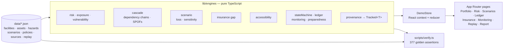

<div align="center">

<a href="https://techmines.github.io/"></a>

# Nexora

**Pre-disaster resilience intelligence for industrial facilities — risk, losses, insurance gaps and response readiness, every number traceable to its source.**

[](https://github.com/TECHMINEs/Nexora/actions/workflows/ci.yml)


</div>

Nexora models how floods, cyclones, toxic releases and grid outages would hit a specific facility. It covers which assets fail, how failures cascade through dependencies, what the losses and insurance gap would be, and how quickly responders could get there. Every figure carries its sources, assumptions and a confidence score, so it can be defended in front of an insurer or a board.

> All facilities and figures in this build are **illustrative synthetic data**; the app shows a persistent demo banner.

---

## Architecture



Nexora has no backend. All computation runs deterministically in the browser over a versioned dataset, so the same inputs always produce the same, auditable outputs.

## Tech Stack

- **Framework:** Next.js 14 (App Router), React 18, TypeScript (strict)
- **UI:** Tailwind CSS 3, Radix UI primitives (dialog, select, slider, tabs, tooltip and more), class-variance-authority, lucide-react
- **Charts:** Recharts (stacked loss decomposition, tornado sensitivity, signal timelines) and custom SVG schematics
- **State:** a React context with a typed reducer (ledger transitions, scenario overrides, replay stepping)
- **Testing:** a golden-value verification suite run with `tsx`

## Local Setup

**Prerequisites:** Node.js 20+ and npm 10+. No environment variables or services are needed.

```bash
git clone https://github.com/TECHMINEs/Nexora.git && cd Nexora
npm install
npm run dev          # http://localhost:3000
```

| Command | Purpose |
|---|---|
| `npm run verify` | Run the 377 golden-value engine assertions |
| `npm run typecheck` | Strict TypeScript check |
| `npm run lint` | ESLint (`next/core-web-vitals` and `next/typescript`) |
| `npm run build && npm start` | Production build and server |

## Key Features

- **Portfolio intelligence:** a multi-facility roll-up of total protection gap, open critical actions, evidence-backed rate and mean preparedness.
- **Risk explorer:** hazard × asset exposure and vulnerability with Low/Medium/High bands, adjusted for verified mitigations.
- **Cascade engine:** enumerates dependency chains (for example utility → equipment → production line) and flags single points of failure.
- **Scenario studio:** stress-test sliders (downtime, inventory loss, supplier interruption). Losses are decomposed into physical, inventory, business-interruption, extra-expense and supply-chain components, with a sensitivity tornado.
- **Insurance adequacy:** policy schedules compared against modelled losses to show the protected and exposed gap.
- **Resilience ledger:** mitigation actions move through an evidence-gated state machine; an action can't be marked "verified" without evidence. Actions are ranked by urgency × likelihood × impact.
- **Emergency accessibility:** responder travel, dispatch and mobilisation time for each facility.
- **Monitoring and early warning:** threshold tables, advisories and alert-quality checks.
- **Historical replay and lifecycle:** step through real-world event timelines, with BCP mode cards driven by the event state machine.
- **Evidence and report:** a source register, an assumption register and a print-ready report export.

## Engineering Highlights

- **Provenance as a type.** Computed values are `Tracked<T>`, carrying their source IDs, assumption IDs and a confidence score derived from each source's authority and licence. The UI renders these as confidence chips and source badges, so no number appears without its lineage.
- **Pure, deterministic engines.** There are 16 side-effect-free modules (risk, cascade, scenario, insurance, ledger, priority and more). They are trivially testable and shared by the UI and the verification suite.
- **Golden-value regression suite.** `scripts/verify.ts` asserts 377 expected outputs across every engine. A change to any formula, threshold or dataset fails loudly.
- **Graph analysis on dependency networks.** Chain enumeration and single-point-of-failure detection run over the facility dependency graph to explain *why* a scenario cascades.
- **Event-sourced state machine.** Historical replay folds an ordered event stream through `nextEventState`, so any timeline step can be reconstructed exactly.

## Known Limitations

- **No persistence:** synthetic data only, and the demo state resets on reload (by design).
- **Indicative outputs:** the risk model is not certified actuarial advice. The insurance view repeats this in the UI.

---

<div align="center">

Created by **Pranav Jangid** | [**TECHMINES**](https://github.com/TECHMINEs)

</div>
